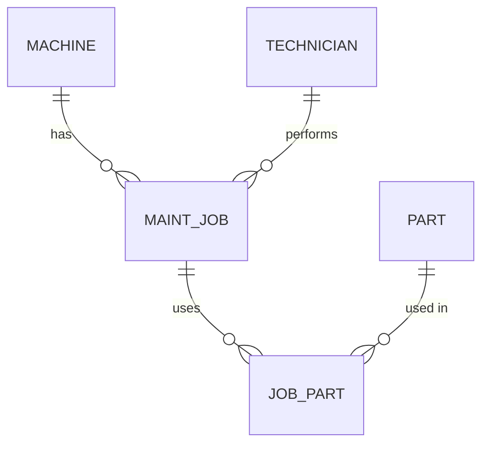
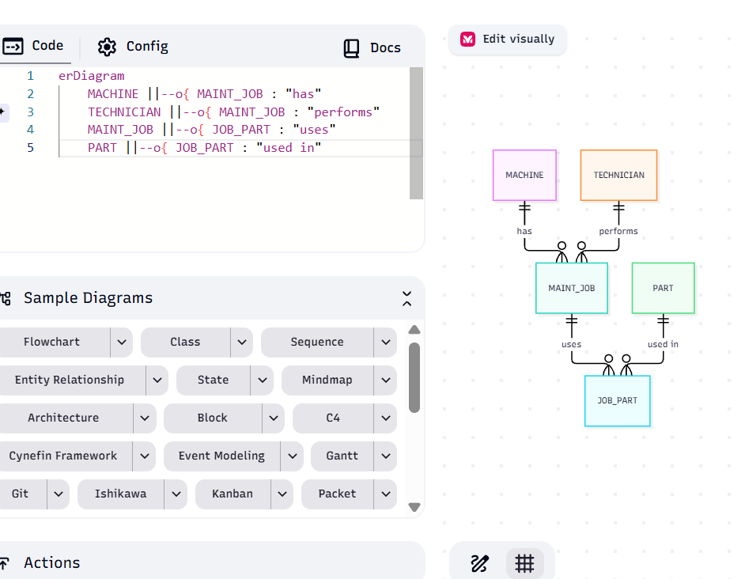

# ER Audit: legacy.db

## Entities in the schema

| Table | Attributes | Intended primary key |
|---|---|---|
| machine | machine_name, serial_no, site, installed | serial_no (unique, 4 of 4) |
| part | part_no, description, unit_price | part_no (but 4 rows, only 3 distinct) |
| maint_job | job_id, machine_name, technician, done_on, parts_used | job_id |

## Entity the designer meant but never created
- Technician: right now only a name in `maint_job.technician`.

## Reconstructed ER diagram

## Cardinalities (proved with counts)
- **1:1:** the schema models none, and none is needed here.
- **1:n** machine to maint_job: hidden. It exists only as a text name, with no foreign key.
- **1:n** technician to maint_job: hidden, because technician is just a text column.
- **m:n** maint_job to part: hidden in the `parts_used` text column. Job 1 lists 2 parts, which `cardinality-proof.txt` shows.