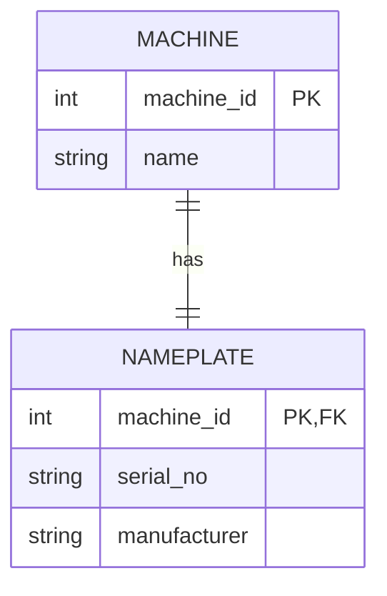
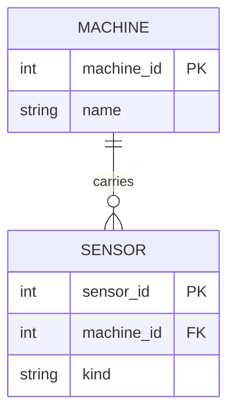
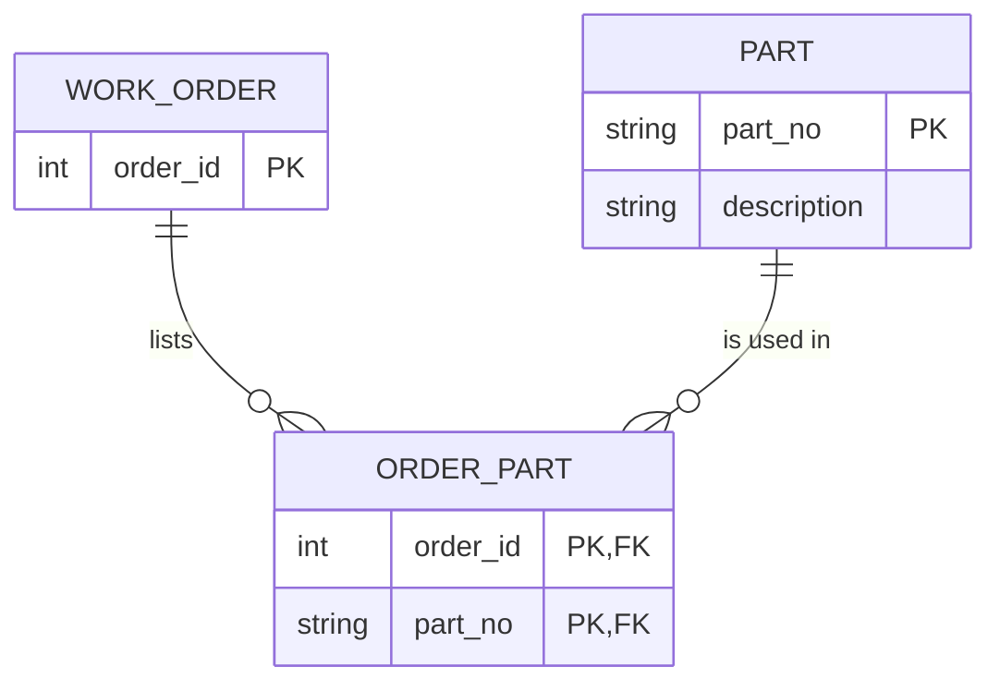
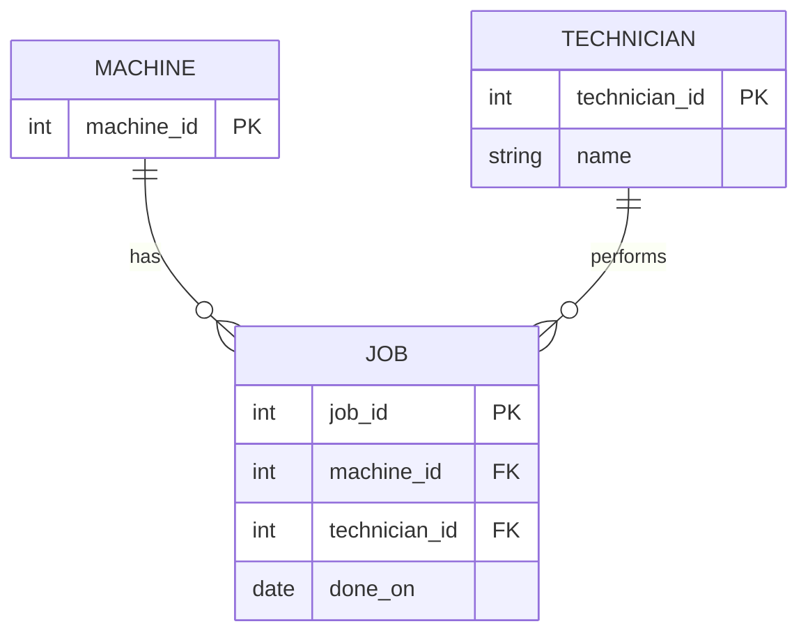

# Study Log, Module 2

[Back to Module 2](README.md) | [Back to main portfolio](../README.md)

Done with my pod ([Smit](https://github.com/[username]/[repo]), [Champu](https://github.com/[username]/[repo]), [Sam Beza](https://github.com/[username]/[repo])) and, for Task C, with the neighbouring pod (Ian, Leviscus, Njeru and Sofia).

## Task A: Study in the pod

### 1. References I used

| Source | The one concept I understood best from it |
|---|---|
| [Wikipedia: Entity-relationship model](https://en.wikipedia.org/wiki/Entity%E2%80%93relationship_model) | An entity is a thing, an attribute describes it, and a relationship links entities with a cardinality |
| [Wikipedia: Natural key](https://en.wikipedia.org/wiki/Natural_key) and [Surrogate key](https://en.wikipedia.org/wiki/Surrogate_key) | A surrogate key has no business meaning, but the natural key still needs a `UNIQUE` constraint |
| [Wikipedia: First normal form](https://en.wikipedia.org/wiki/First_normal_form) | A comma-separated list in one column breaks 1NF and hides a many-to-many relationship |
| [sqlite.org/foreignkeys.html](https://sqlite.org/foreignkeys.html) | SQLite does not enforce foreign keys unless `PRAGMA foreign_keys = ON` is set |
| [Pydantic](https://docs.pydantic.dev/) and [SQLAlchemy](https://docs.sqlalchemy.org/) docs | Pydantic validates data in the application, SQLAlchemy describes the tables the database enforces |

### 2. Things I googled

| Term or question | What I found | Source |
|---|---|---|
| Why does a comma-separated column break 1NF? | Each cell must hold one atomic value, so a list needs its own table | Wikipedia: First normal form |
| Are SQLite foreign keys enforced? | Not by default, they must be switched on per connection | sqlite.org/foreignkeys.html |
| How do I draw a many-to-many in an ER diagram? | With a junction table that holds both keys | Wikipedia: Entity-relationship model |

### 3. Remarkable things

- **A name looked like a key but was not one:** `machine_name` has no constraint, and `maint_job` contains `cnc-05`, a machine that does not exist.
- **The join succeeded and still lost data:** joining `maint_job` to `part` on `parts_used` dropped job 1 (`'P-1001,P-1002'`) without any error.
- **Text prices compare like text:** `unit_price < '15'` returns only P-1001 (12.50). The cheaper P-1003 (9.90) is missed, because the text `'9...'` sorts after `'15'`.
- **The "date" column holds `'unknown'`:** one machine has `installed = 'unknown'`, which no date type would accept.

### 4. LLM Q&A

| Prompt | Summary of the answer | How I verified it (and where it was wrong) |
|---|---|---|
| [paste the prompt you really used] | [2 to 3 lines] | [how you checked it, and where it was wrong or vague] |
| [paste a second prompt] | [2 to 3 lines] | [how you checked it, and where it was wrong or vague] |

### 5. My two best found ER sketches

Both are in [er-sketches.md](er-sketches.md). They were generated with an LLM, and I checked them myself.

**[Sketch 1: University registration](er-sketches.md#sketch-1-university-registration)**
- Source: LLM-generated, redrawn in Mermaid.
- What I learned from it: `ENROLLMENT` is a junction table between students and course offerings, and it also carries its own attribute (`grade`). [Edit if you learned something different.]

**[Sketch 2: Machine maintenance](er-sketches.md#sketch-2-machine-maintenance)**
- Source: LLM-generated, redrawn in Mermaid.
- What I learned from it: a breakdown report leads to work orders, and a machine keeps its history in a separate table instead of in columns. [Edit if you learned something different.]

## Task B: From words to sketch

### 1. One-to-one: machine and nameplate

The nameplate shares its key with the machine, so each machine has at most one nameplate and each nameplate belongs to exactly one machine. I treat it as a separate entity because it has its own attributes.



### 2. One-to-many: machine and sensors

The foreign key sits on the "many" side, so `sensor` holds `machine_id`.



### 3. Many-to-many: work orders and parts

The extra table is `order_part`. Its key is the pair (`order_id`, `part_no`), which also makes sure an order lists a part only once.



### 4. Job, machine and technician

The job is an entity, not just a relationship, because it has its own attributes (date, parts). The technician is an entity too, not just a name, so one person is stored once and many jobs point to them.



### CREATE TABLE and COUNT proof (sketch 2, one-to-many)

```sql
PRAGMA foreign_keys = ON;

CREATE TABLE machine (
    machine_id INTEGER PRIMARY KEY,
    name       TEXT NOT NULL
);
CREATE TABLE sensor (
    sensor_id  INTEGER PRIMARY KEY,
    machine_id INTEGER NOT NULL REFERENCES machine(machine_id),
    kind       TEXT NOT NULL
);

INSERT INTO machine VALUES (1, 'cnc-01');
INSERT INTO sensor  VALUES (1, 1, 'vibration'), (2, 1, 'temperature');

-- one machine, many sensors; each sensor points to exactly one machine
SELECT machine_id, COUNT(*) AS n_sensors FROM sensor GROUP BY machine_id;
```

Result: `machine_id = 1`, `n_sensors = 2`. Machine 1 has two sensors, while each sensor row has exactly one `machine_id`, so the relationship is one-to-many.

## Task C: Explain and share with the neighbouring pod

We explained our study logs and sketches to each other and asked questions.

**Agreed learning (pod discussion)**

- A natural key without `UNIQUE` is not a key.
- Many-to-many relationships need a junction table, and a list in a column hides one.
- Prove cardinalities with `COUNT` queries, not by looking at the drawing.
-
