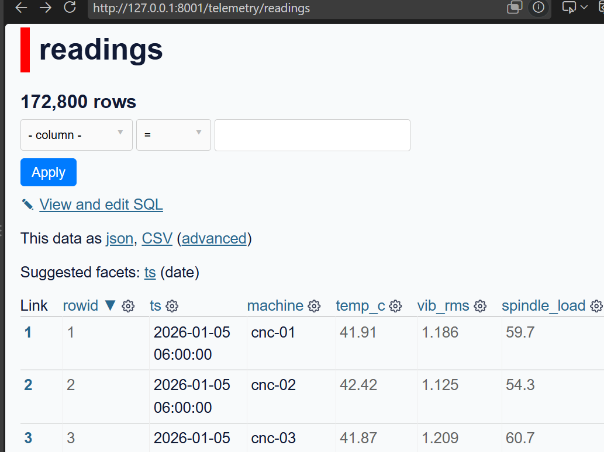
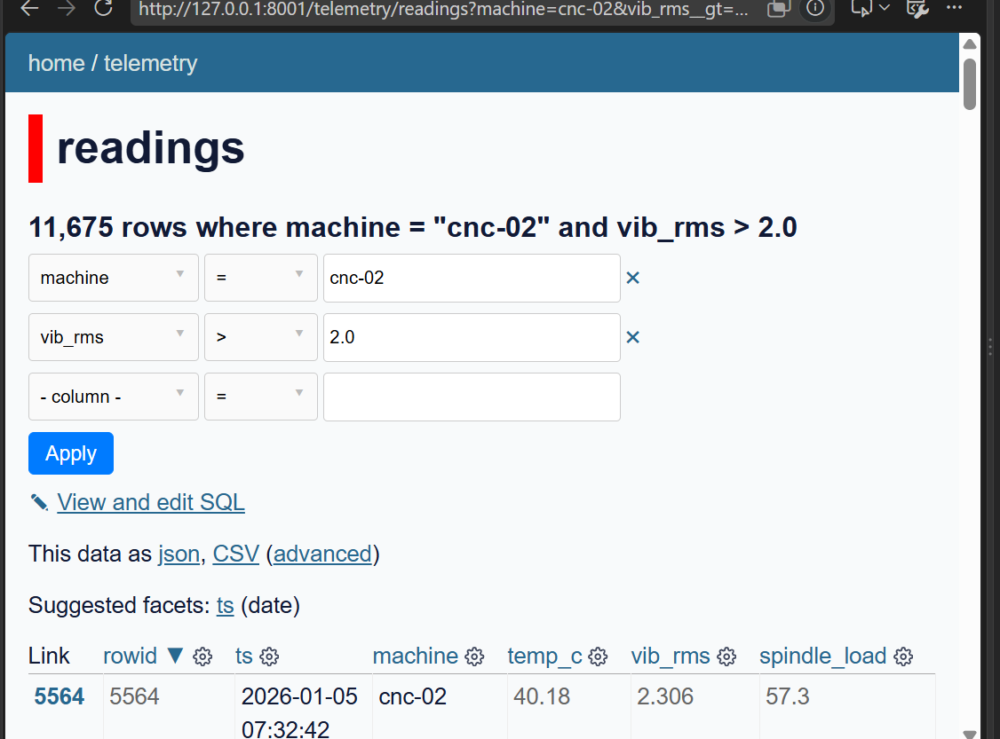

# Task 8: Publish your data with Datasette

I started Datasette with `uv run datasette module-01/telemetry.db -o` and explored the readings table (172,800 rows).

I filtered by machine = cnc-02 and vib_rms > 2.0, which gave 11,675 rows.

- Alarm readings above 2.0: cnc-01 has 21, cnc-02 has 11,675 and cnc-03 has 18, which add up to 11,714, the same number as my total count.
- What I noticed: almost all alarms come from cnc-02, which shows the bearing wear built into the data.